# Arena #546 browser evidence

These screenshots show the same artwork-grounded contract fixture at 390×844 and 1440×900 in both Arena skins. `*-offline-before.jpg` was captured against base HEAD `74701713`, before this connection UI existed. `*-offline.jpg` and `*-reconnecting.jpg` show the persistent state and working Retry affordance; `*-recovered.jpg` shows a higher-revision terminal response, the Victory overlay, and the cleared connection warning.

The browser script uses Chrome DevTools Protocol network emulation. It writes `contract/fixtures/arena-live-proof.json` from the existing versus fixture for the duration of the run and removes it in `finally`. The two card IDs in that temporary fixture map to the real Senzu Bean (BT11-053) and Whis’s Coercion (BT1-055) artwork already present in the workspace’s Arena design assets. CDP serves those local bytes and intercepts every `/api/v1/games/1` request: transient requests receive a controlled 503; after the browser returns online, the test provides a same-game snapshot at a higher revision with a real winner. The local Next dev server serves only the dev-only preview route and existing ArenaCard; no game API route, database, external image request, or live game server is involved.

The initial visual test fixture is deliberately illustrative: the two real Extra cards are shown in the sample hand so the artwork loads through the existing card component. It is not a game-state or deck-legal assertion. The controller verification separately proves offline/foreground behavior, aborts, stale and cross-game response rejection, terminal status, capped backoff, and Retry.

| State | Anime phone | Night phone | Anime desktop | Night desktop |
| --- | --- | --- | --- | --- |
| Before #546, offline | 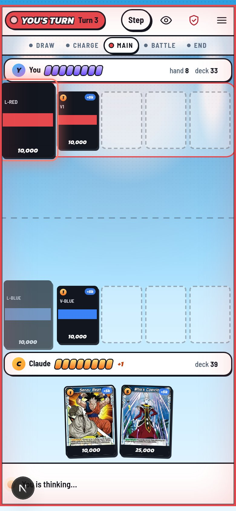 | 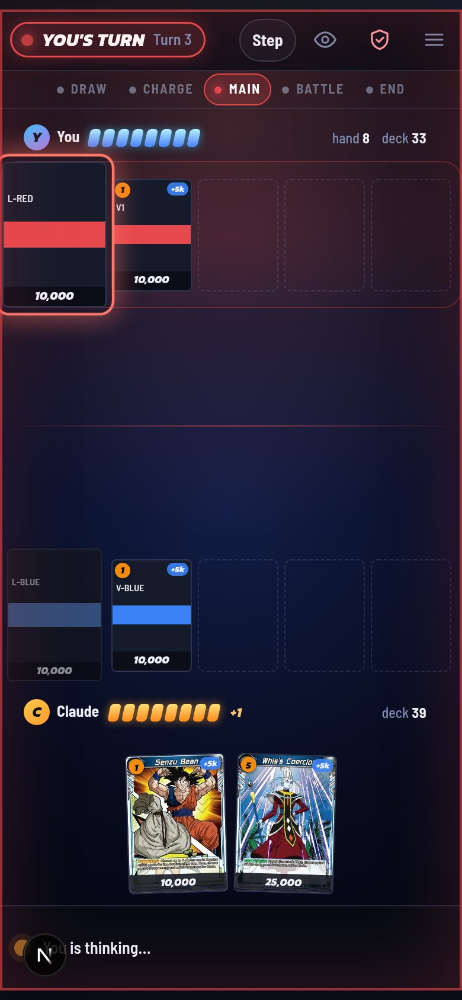 | 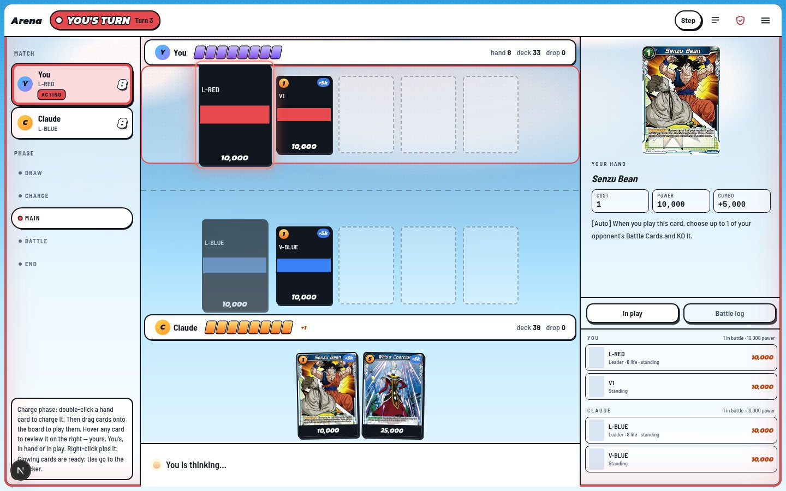 |  |
| Offline | 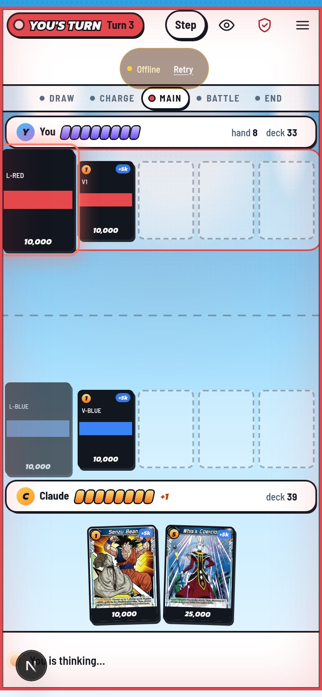 | 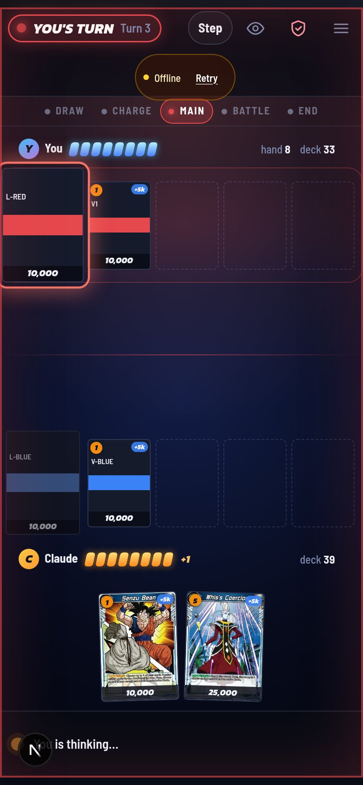 | 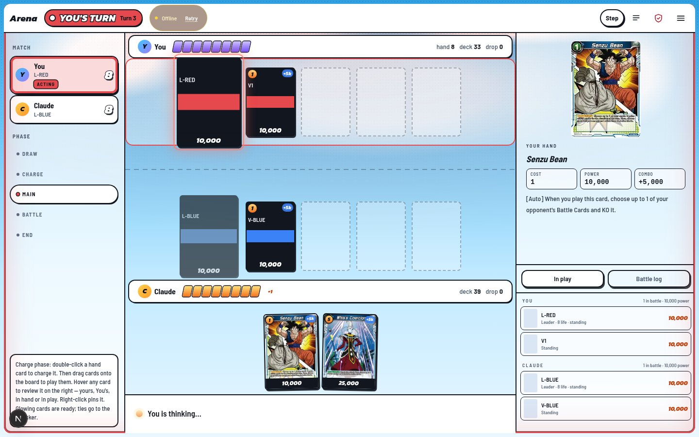 |  |
| Reconnecting | 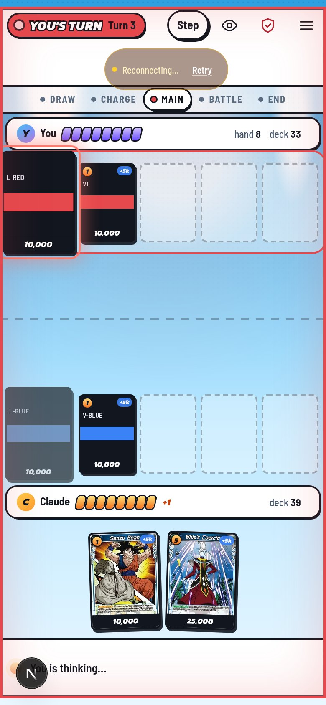 | 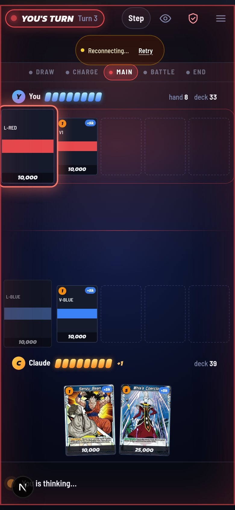 |  | 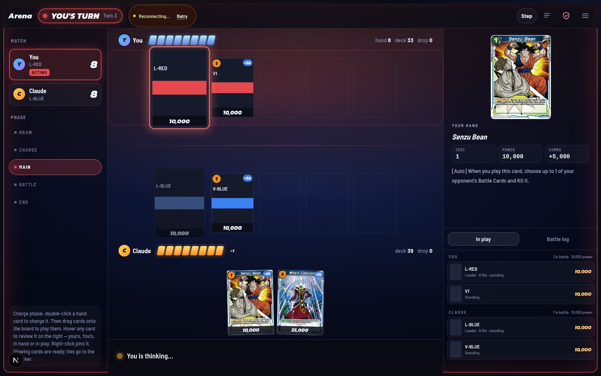 |
| Recovered terminal revision | 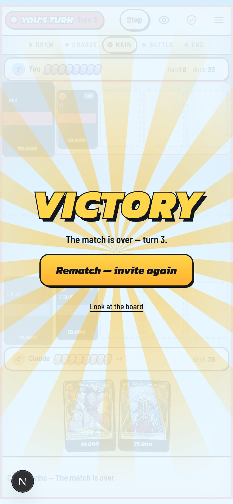 | 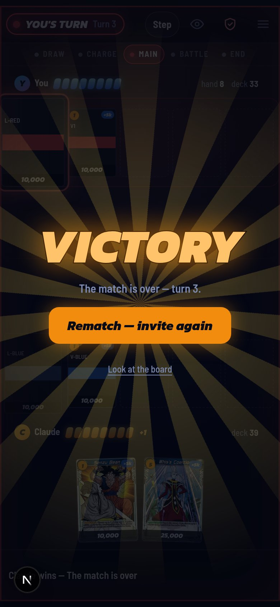 | 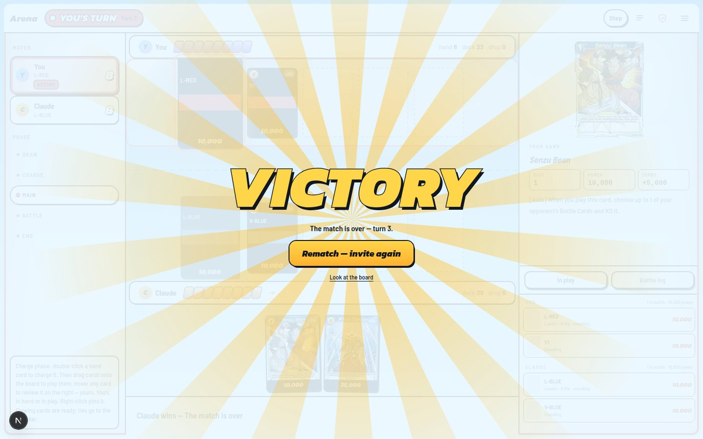 | 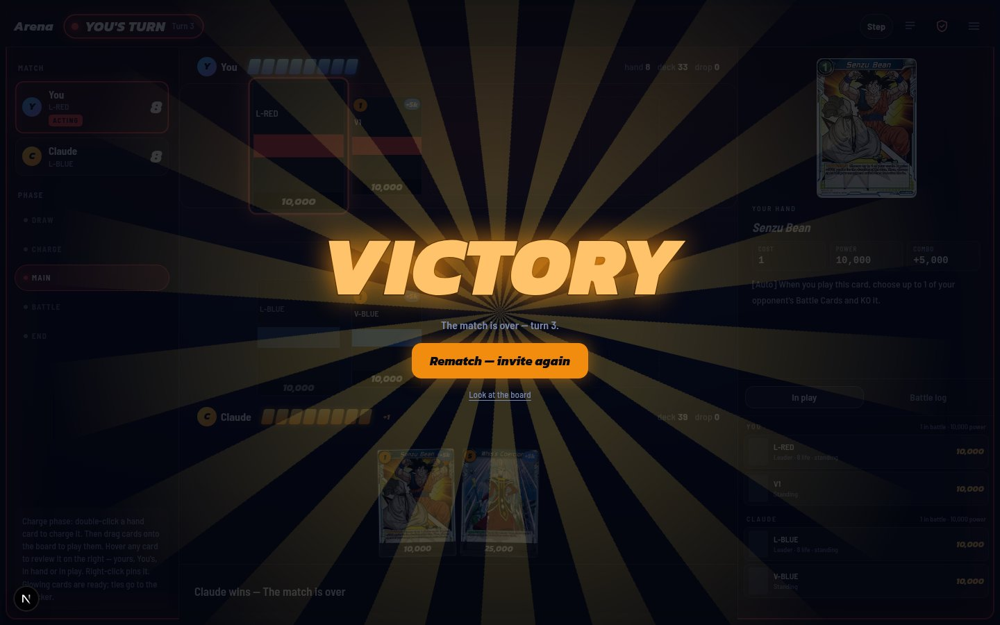 |
