# Arena #547 browser evidence

The before captures run the unchanged ArenaStage and admin drawer from base `74701713`; the after captures run this branch. Both use the app's existing development-only `/arena/preview` route and its `versus` contract snapshot. The harness writes a temporary visual-only copy of that snapshot with the Senzu Bean (BT1-053) artwork attached to the visible leader, then removes it in `finally`. The committed WebP is the local card image used by the harness. This fixture demonstrates the board and drawer UI; it does not assert a playable game state or exercise server-side page authentication.

At each viewport and skin the script opens the actual ArenaStage admin control. Before #547, the drawer has no replay download link. After #547, it clicks the actual link and waits for Chromium's `Browser.downloadWillBegin` and completion events. It checks the suggested filename (`arena-game-1-replay.json`), reads the downloaded file, and validates the export fields. The replay request is intercepted with a small JSON response in the same shape as a historical unpinned export; normal game polling is answered with the temporary snapshot fixture. No database, live game, external image server, or production API is used. The authorized versus-seat/export behavior is separately exercised against PGlite in `scripts/verify/arena-replay.ts`.

Run `DATABASE_URL='' npm run dev` in the worktree, then run `DATABASE_URL='' npx tsx scripts/verify/replay-browser-evidence.mts`. For the before state, use the same script and asset on base `74701713` with `ARENA_CAPTURE_BASELINE=1`. The harness needs the system Chromium discoverable by `scripts/lib/cdp.mts`.

| Capture | Anime phone | Night phone | Anime desktop | Night desktop |
| --- | --- | --- | --- | --- |
| Board with loaded local card artwork, before |  |  |  | 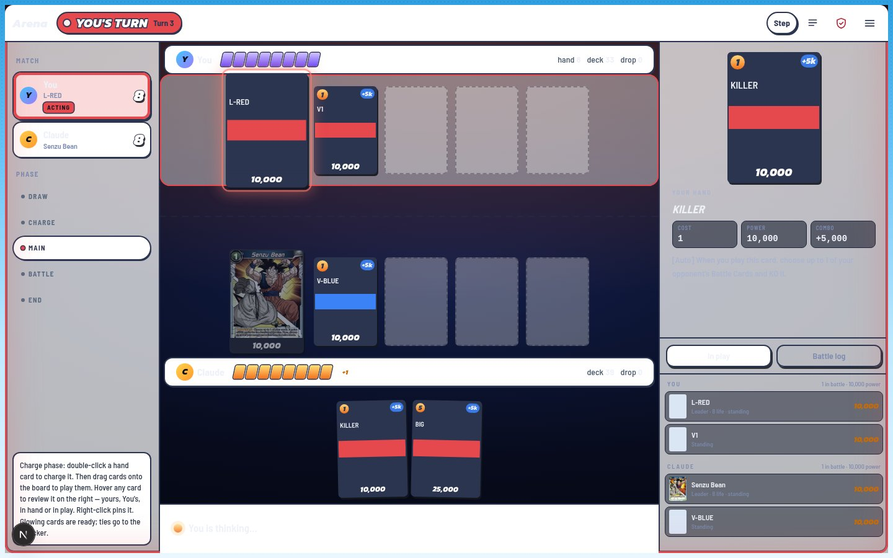 |
| Admin drawer, before | 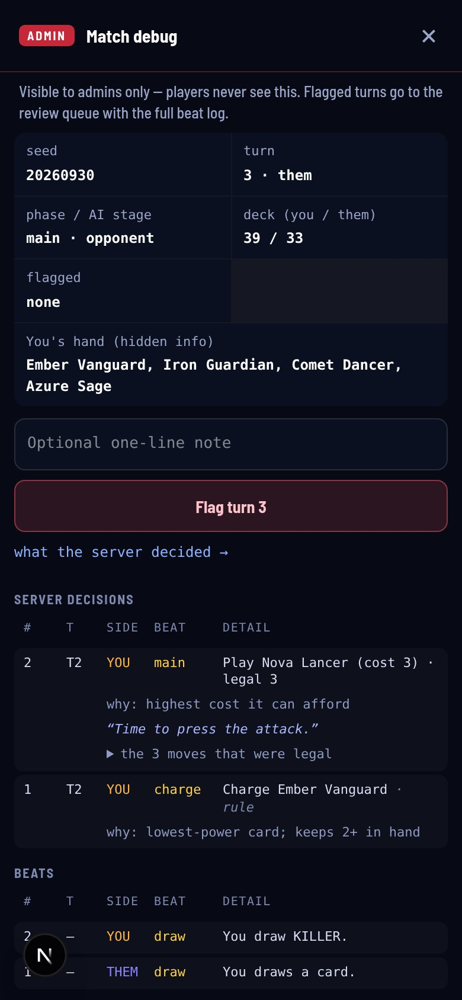 |  | 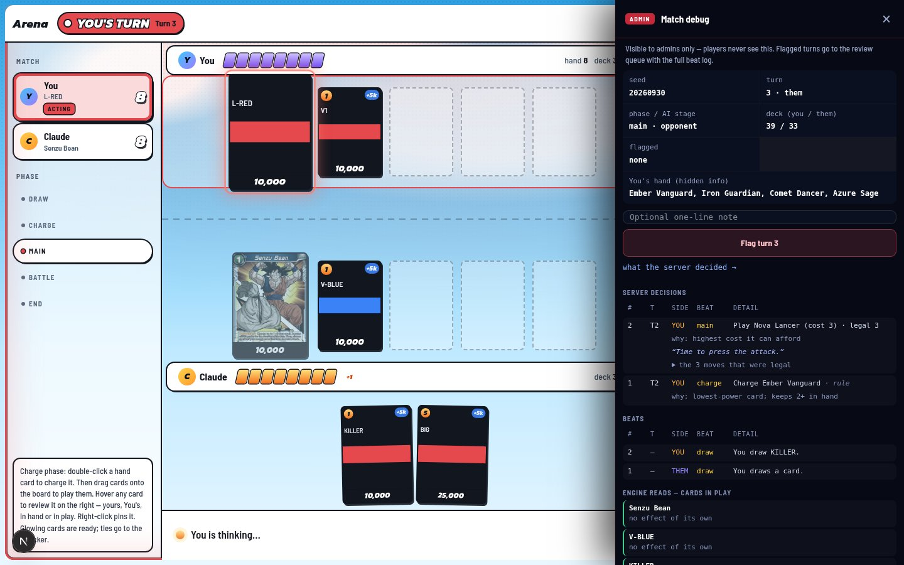 | 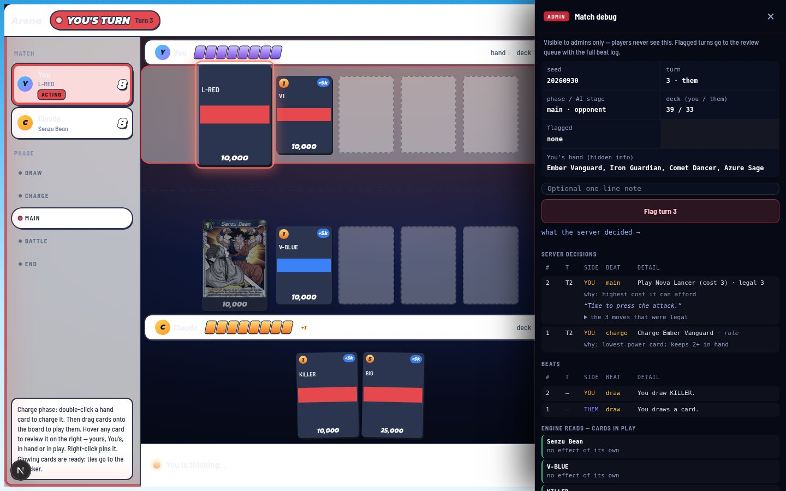 |
| Board with loaded local card artwork, after | 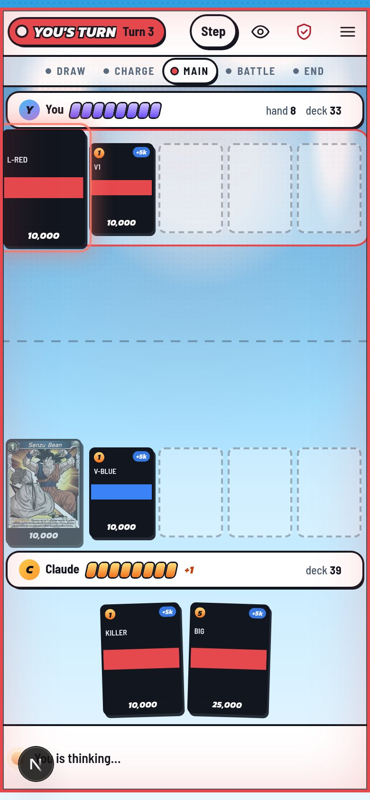 | 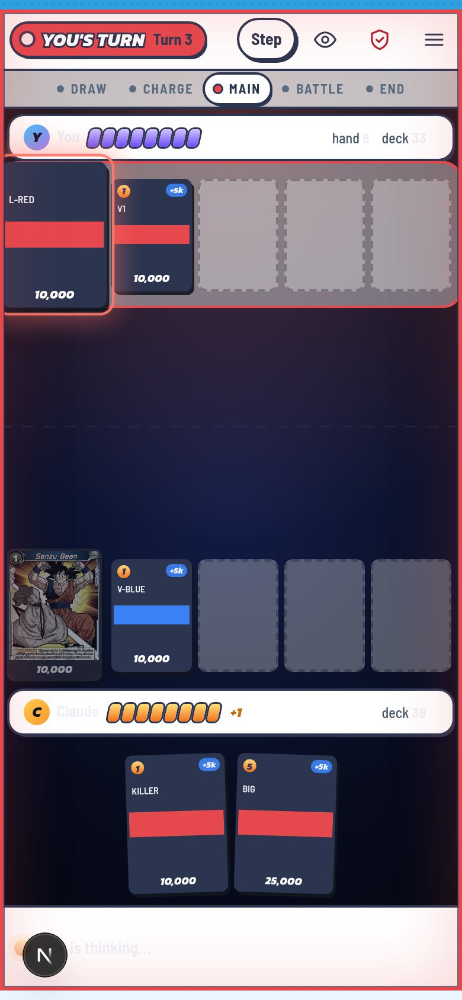 | 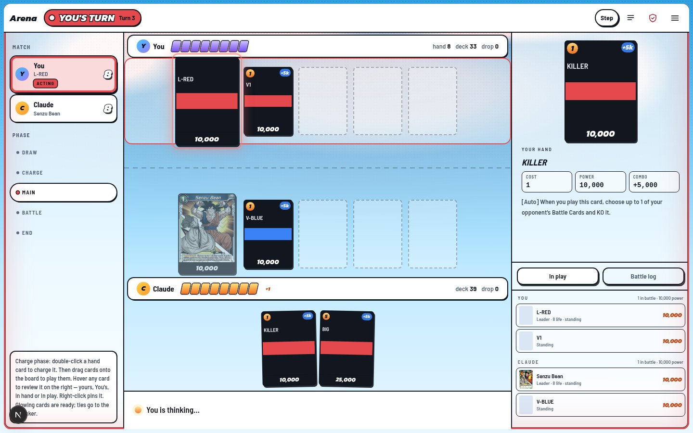 | 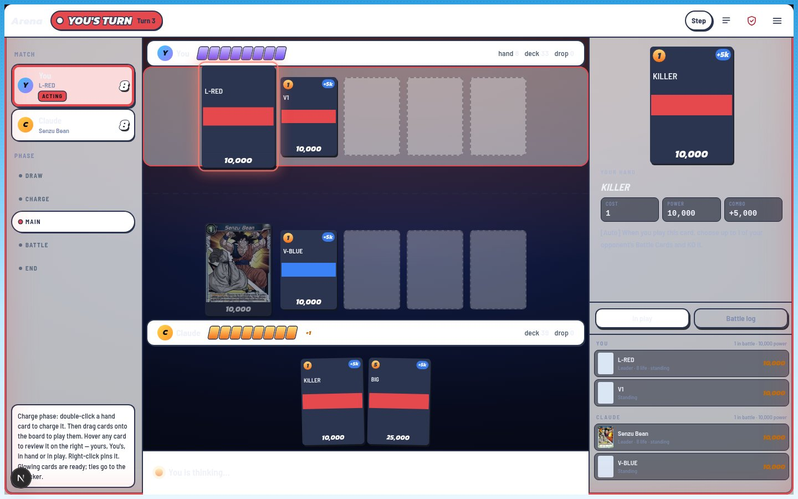 |
| Admin drawer and replay link, after |  | 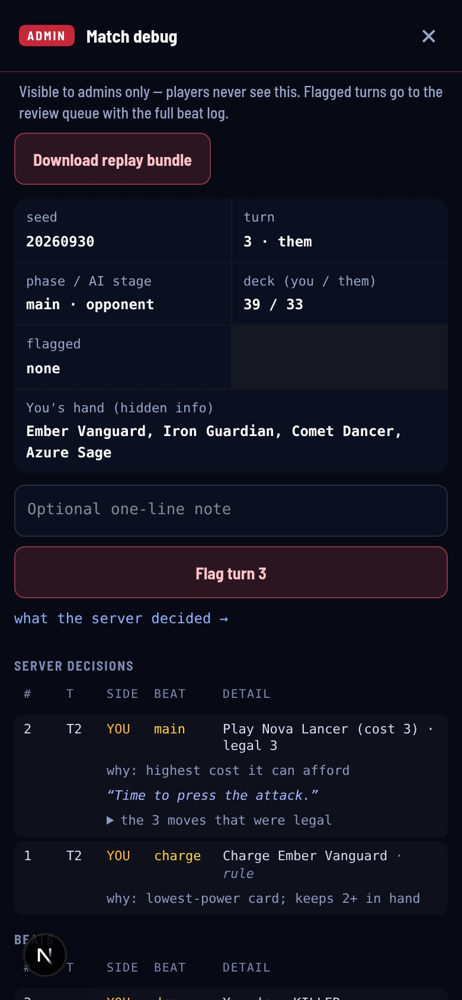 | 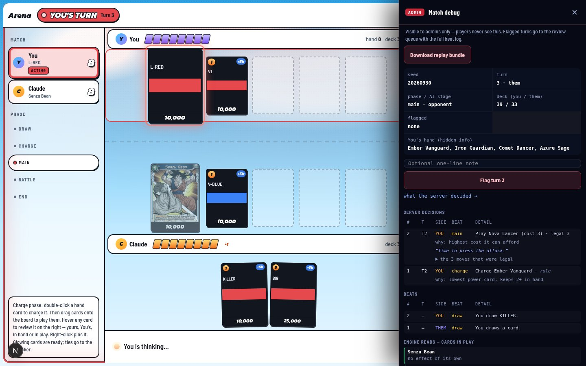 | 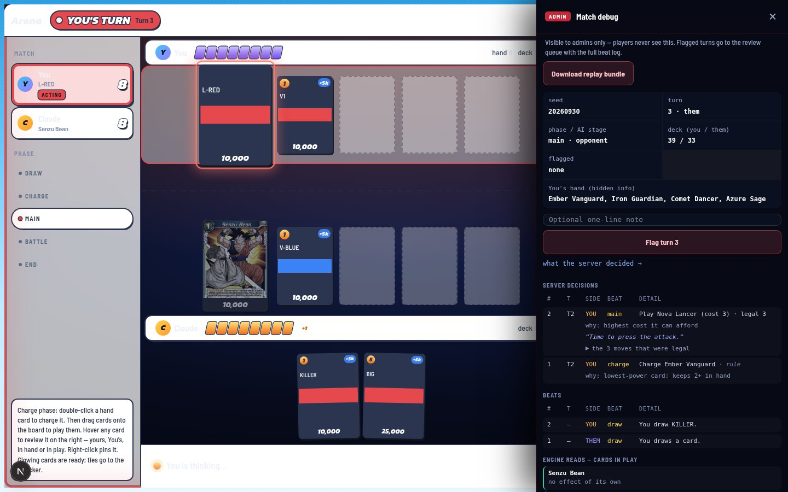 |

The four saved `*-download.json` files are the bytes actually downloaded by Chromium for each viewport/skin run.
