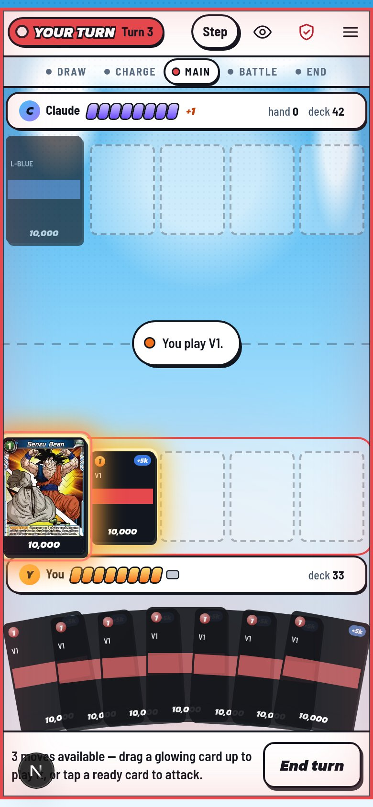
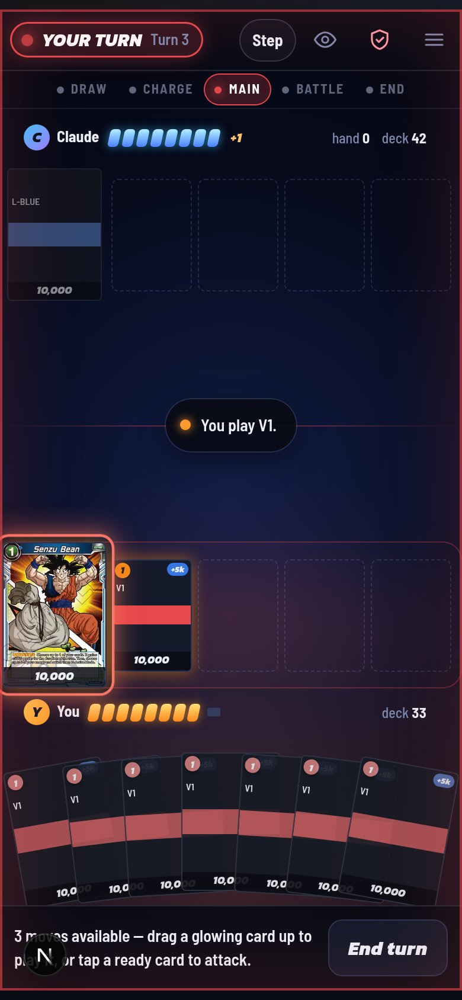
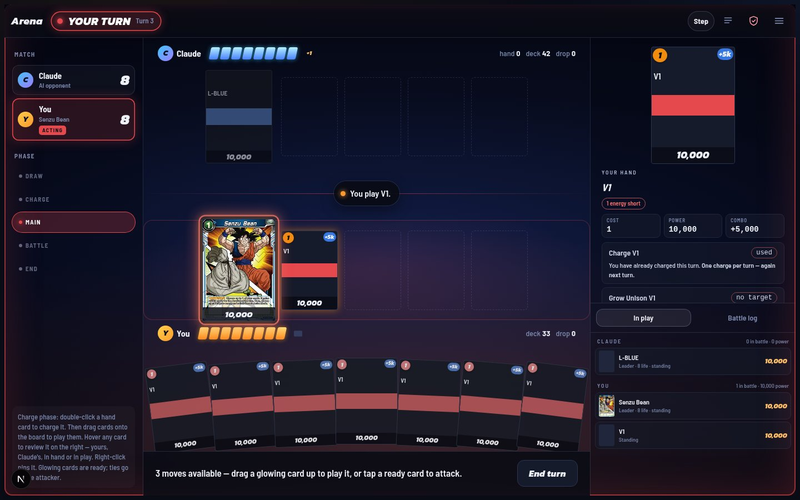
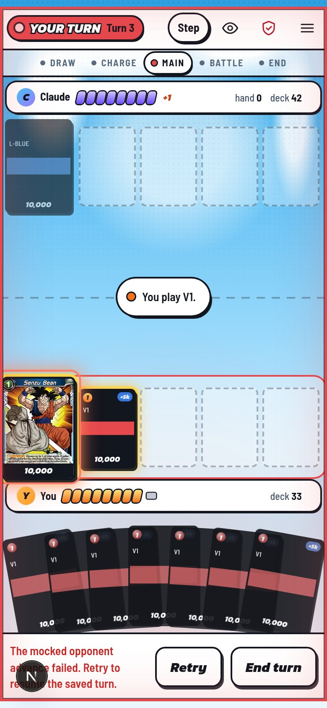
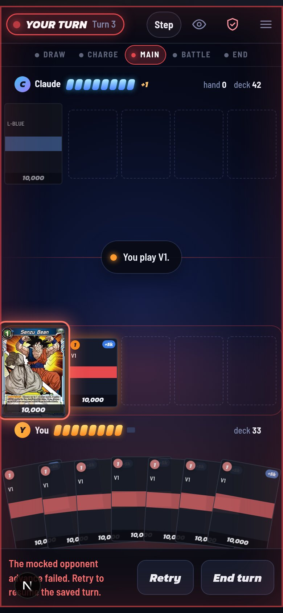
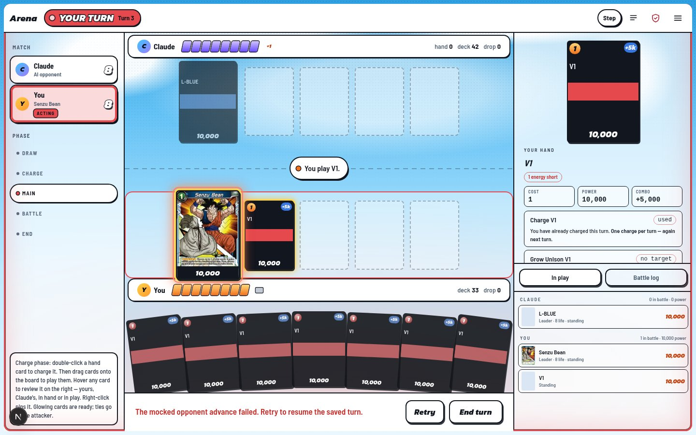
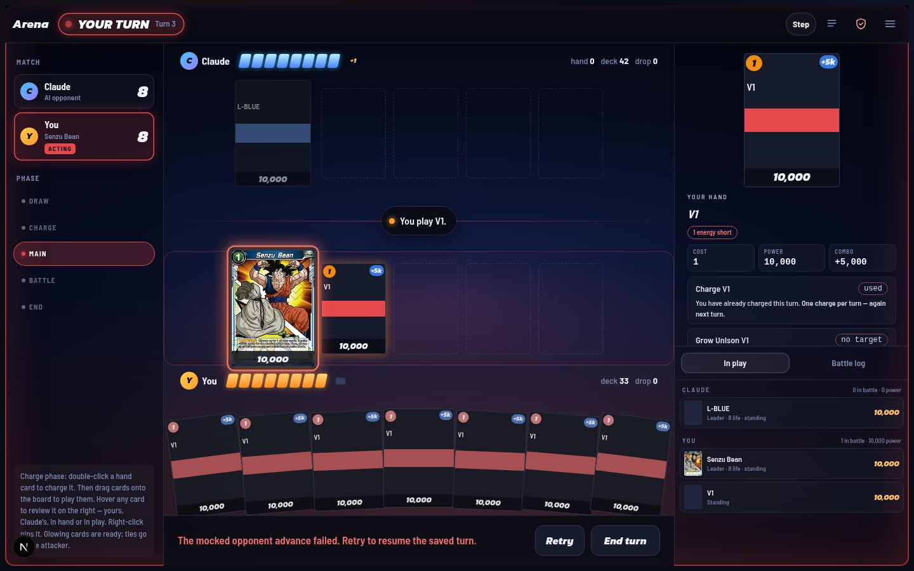
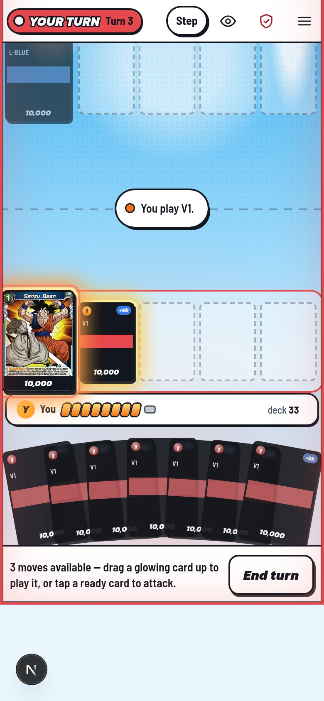
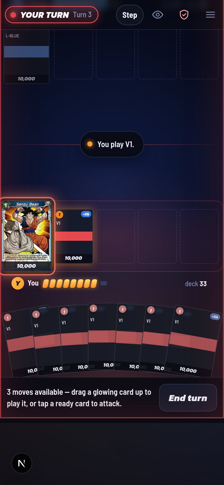

# Arena #566 browser evidence

The before captures use the unchanged ArenaStage from base `74701713`; after captures use this branch. Both run through the existing development-only `/arena/preview` route with a temporary copy of the `play` Snapshot fixture. The local Senzu Bean image committed beside these files is returned by CDP interception and verified loaded before capture.

The after run clicks the preview's real `End turn` action. The preview's fake server action records one `act` call, returns an advance error once, and records the separate `advance` requests. The test waits for the enabled Retry button, checks its 44×44 minimum target and keyboard focusability, then taps it. Assertions prove Retry makes a second advance request without repeating the human action and clears the error. The temporary Snapshot file is removed in `finally`. Snapshot polling is intercepted as a local 404; no game API, database, live provider, or production route participates.

This is UI evidence over the real ArenaStage and PromptPanel, not a live game or a backend assertion. PGlite lease, recovery, accounting, and revision-CAS evidence is in `scripts/verify/arena-advance-leases.mts`.

| State | Anime phone | Night phone | Anime desktop | Night desktop |
| --- | --- | --- | --- | --- |
| Before #566 |  |  |  |  |
| Advance error and Retry |  |  |  |  |
| Retry completes |  |  |  |  |

Capture commands:

```sh
DATABASE_URL='' npm run dev -- --port 3022
ARENA_BASE=http://localhost:3022 DATABASE_URL='' npx tsx scripts/verify/arena-advance-browser-evidence.mts
```

For the before set, run an unchanged `74701713` worktree on port 3021 and set `ARENA_CAPTURE_BASELINE=1` plus `ARENA_PREVIEW_ROOT=/path/to/the/74701713/worktree`.
