# Phone navigation and card reading — #832

Captured on 15 October 2026 using a sanitized secondary PostgreSQL database, never production writes. Phone pages are 390 × 844 CSS pixels; the engine-backed mulligan is 360 × 800; laptop pages are 1366 × 768. Images are captures of the implementation, not mockups. Local Chromium exercises actual touch gestures through CDP; Tiny Fish's earlier live session used a desktop viewport and could not emulate a phone.

## Findings and decisions

Live Tiny Fish audit: https://agent.tinyfish.ai/runs/93d8c4be-f9fc-476d-a292-dbc271dce587 . It navigated the signed-in app and an existing match read-only. Its useful findings were unclear planning language and lost navigation context. Source inspection verified that the app already had five bottom tabs, but hid them on the Arena hub. The phone battle log already overlays the board; deck setup already uses a full-screen wizard. Those inferred deficiencies did not justify rebuilding either feature. Admin destinations remain gated.

The planner previews moves selected by the player; it does not suggest tactics. It therefore moves from the normal turn prompt into Board controls → **Try moves without playing**, with an explanation of its scope and effect. Its transport, revision checks and pure simulation remain unchanged.

The reported mulligan problem combines an image-heavy panel with collapsed written text. Before changes, our Chromium test could scroll both normal hand and mulligan reviews; we did not reproduce a total inability to scroll on the user's physical device. The repair makes full printed text expanded, adds a fixed **Read card text** jump, gives the body native vertical scrolling, and stops interpreting cancelled scroll pointers as close/page gestures. Paging resets scroll; explicit Close and artwork swipe gestures remain.

Phone navigation now retains Arena / Collection / Cards / Decks / Add tabs on the Arena hub and setup pages. A labeled **Menu** consistently exposes Dashboard, Leaders, Meta & News, and Settings or Me. Active matches retain the whole screen, their Board controls and existing Arena return link; focused rule review retains its own back route.

## Captured walkthrough for Tiny Fish

Review these actual phone captures for legibility, destination labels, tab continuity and clarity of card reading / preview actions. This is a captured review, not an interactive test of a phone. Do not infer gesture behavior from images. Local browser tests cover the interactions.

### Arena and secondary navigation

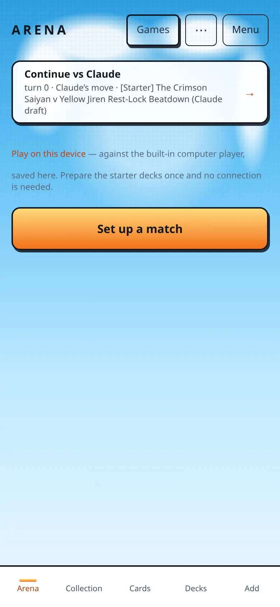
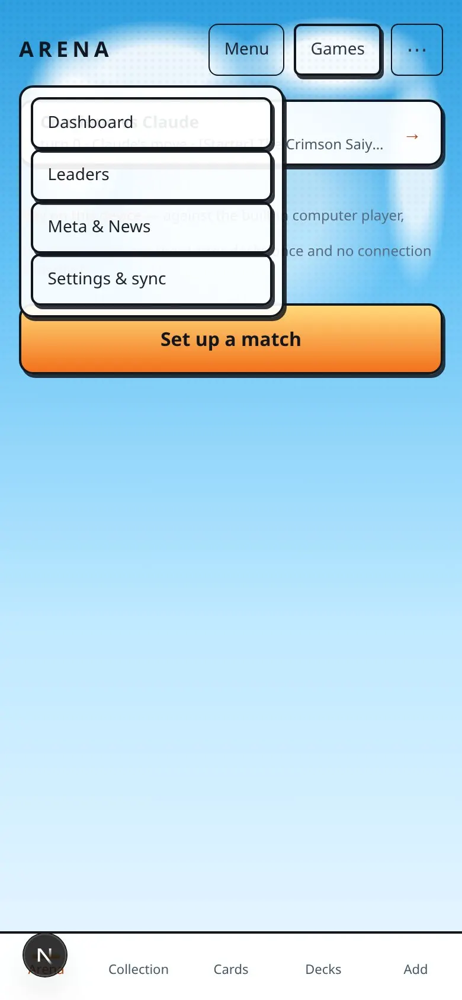

### Decks and leaders

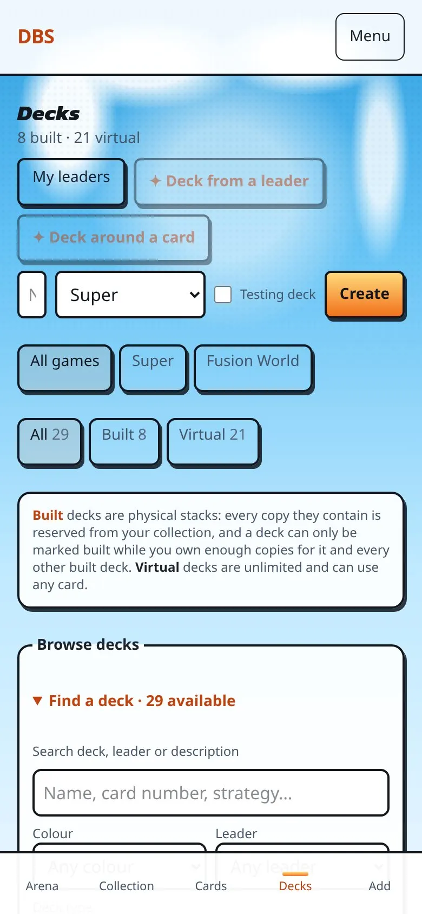
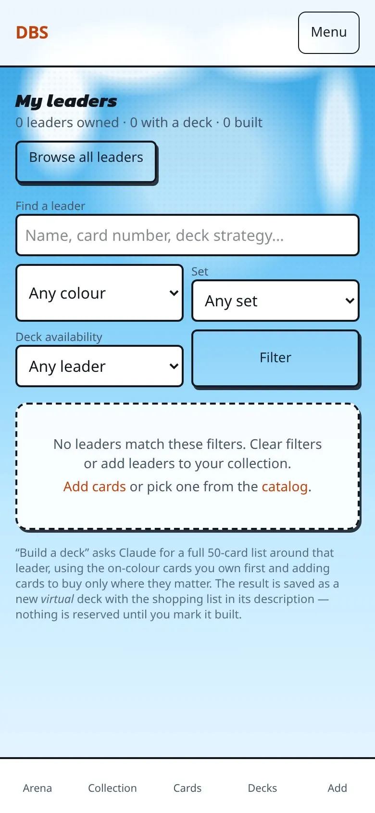

### Other everyday tabs

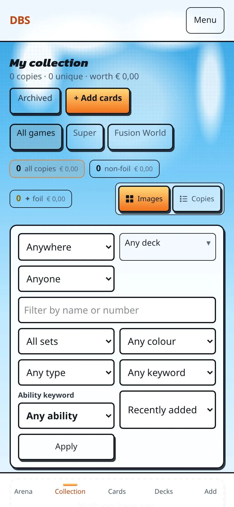
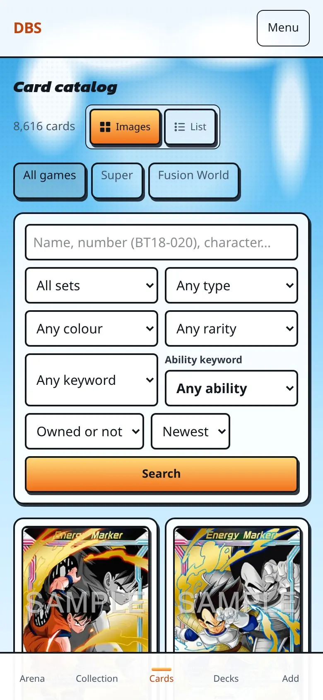
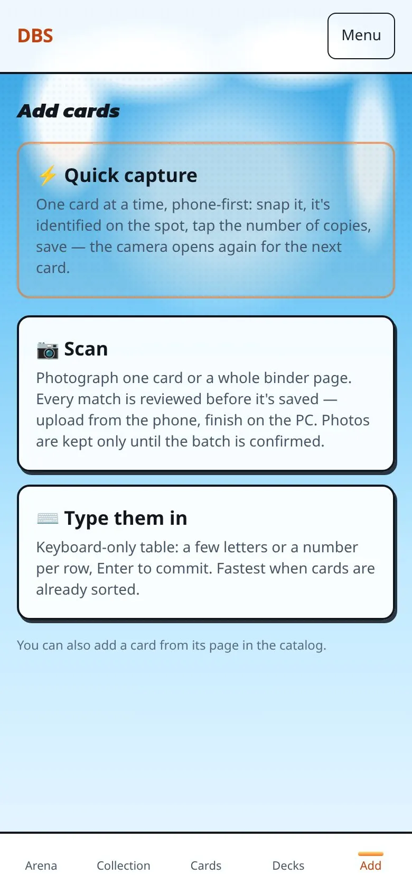

### Mulligan written text and optional preview

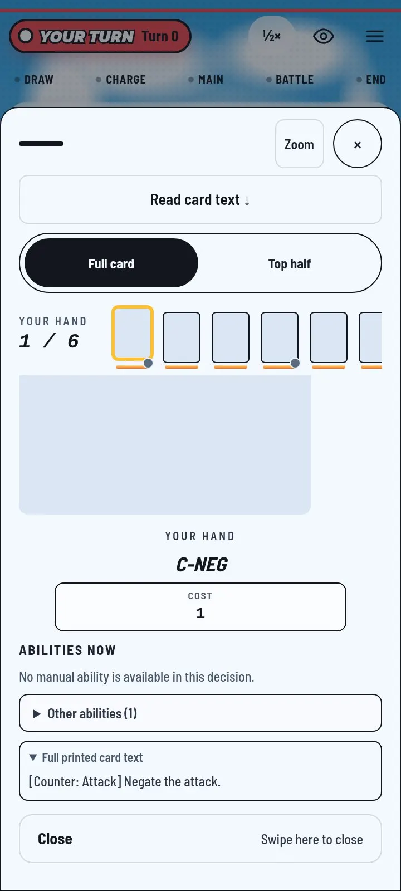
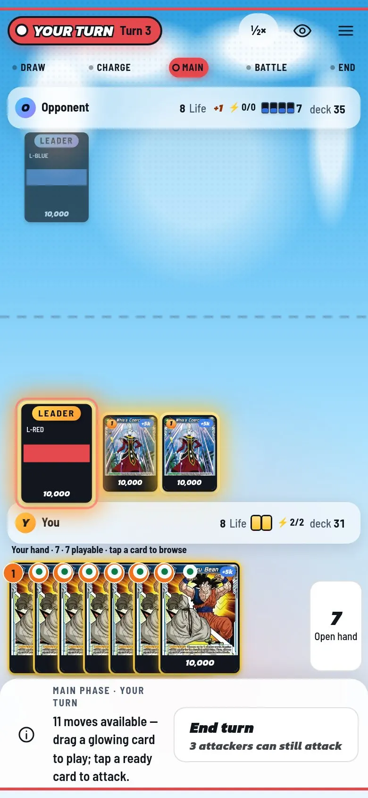
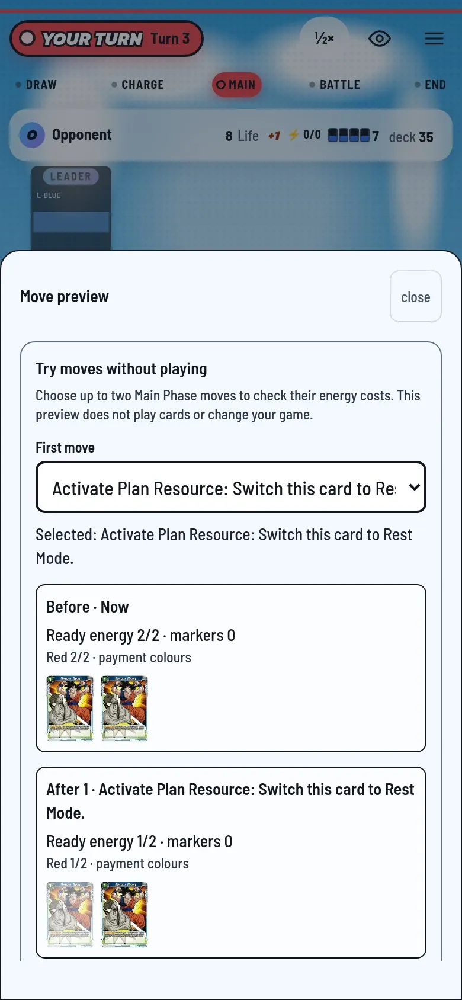

### Laptop reference

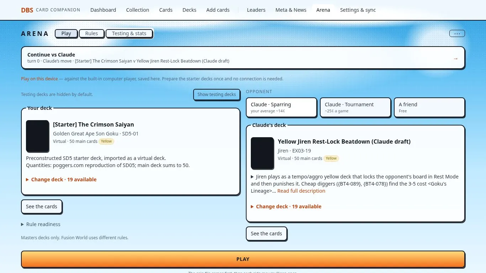
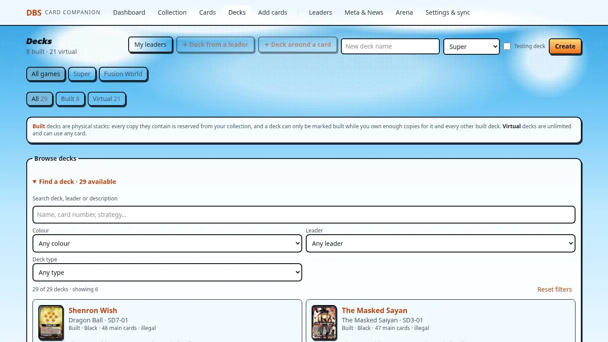

## Reproducible verification

- `node --import tsx scripts/arena-phone-navigation-832.mts --base http://127.0.0.1:3110 --out /tmp/phone-nav/proof`: engine-created mulligan, 360/390 wide, both skins; true touch scrolling in both directions, text jump, paging reset, no submitted mulligan, tabs, Menu → Leaders → Decks, no horizontal overflow. Generated fixture removed in finally.
- `node --import tsx scripts/arena-phone-interactions.mts --base http://127.0.0.1:3110 --out /tmp/phone-nav/interactions`: 360 wide at 800/650 high, both skins; artwork zoom, horizontal paging, attack target review, confirmation/cancel, response choices.
- `node --import tsx scripts/arena-gameplan-570.mts --base=http://127.0.0.1:3110 --evidence=/tmp/phone-nav/planner`: phone/laptop, both skins; optional menu entry, two moves, budgets, transport retry, keyboard clear, 200% text and no submitted game move.

Full-suite results and the supplementary Tiny Fish capture review are recorded below when complete.
