# Rules review: captured walkthrough and guided-flow proposal

Audit for #830. Captured 15 October 2026 from app revision `a891ee99` (fresh production build), using a secondary local PostgreSQL database. Phone: **390 × 844 CSS pixels**, touch emulation, screenshots at 2×. Laptop: **1366 × 768 CSS pixels**. These are current screens, not redesign mockups. The capture theme is Anime.

The owner finds it unclear what these screens do. The objective is a guided procedure with clear descriptions and action labels, keeping only useful features in the main workflow.

## Isolation and evidence

The source snapshot used read-only, repeatable-read transactions. The review app connected only to loopback PostgreSQL: 8,616 cards, 13,615 rule records, 29 decks, and five recent games for queue context. Authentication tables were excluded, owner identities anonymized, feedback payloads removed, and AI credentials omitted from the app process. No production records were changed and no AI drafting was invoked. Only the selected card/deck screens are published here; the database snapshot and connection credentials are not included.

Locally verified on the copy:

- **Skip** advances the session and explicitly leaves the rule in the queue. Undo returns to the item.
- **Wrong → choose reason → Flag for the computer** records a mismatch and removes it from this review session. It remains a draft and is not corrected. Undo restores it.
- **Reads right** changed Babidi's one rule from `draft` to `confirmed`. Undo restored `draft`.
- **Run probe** ran a staged scenario against Bibidi's saved rule and showed input, actions, result and assumptions. This demonstrates observed behavior, not correctness. The result includes Bibidi being KO'd; the headline “power on the board: 10000” alone cannot answer whether the intended skill behaved correctly.
- Opening the block builder runs its generated test boards for the current editor program. No correction or test verdict was saved.

Source inspection, rather than exercised mutations, establishes: approval protects the saved program from compiler overwrites; Skip is session-only; mismatch reporting does not repair a program; editor save records a correction; test judgments are separate from review approval. No bulk approval, AI drafting or “does nothing” action was exercised.

Tiny Fish is to review this **captured walkthrough**, not claim an interactive test of the app. Captions report locally verified outcomes. It should distinguish visible evidence from proposed changes and inferred usability concerns.

## Feature decisions made before the Tiny Fish review

| Screen or function | Decision | Why it still matters |
| --- | --- | --- |
| Rules workbench `/arena/rules` | Keep as the queue and laptop detail view; introduce a guided entry | Find relevant cards, compare interpretation, revisit saved work. |
| One-skill review `/arena/rules/review` | Keep; make it the phone presentation of the same task | Focus on one skill with understandable verdicts and Undo. |
| Deck / card / review-state filters | Keep primary | Start with a relevant deck or named card rather than the whole catalog. |
| All playable Masters decks | Keep available and explicitly label scope | Rules are shared card data across owners; do not silently limit to the current owner's decks. |
| Rules fired in a game | Keep as contextual entry from a game | Investigate a concrete problem without browsing the catalog. |
| Same wording / reason / set / compiler filters | Keep behind More filters | Useful for repeated problems and expert maintenance; unnecessary at first entry. |
| Block builder `/arena/rules/build/[id]` | Keep one canonical correction editor | Needed to repair mismatches and incomplete interpretations. Preserve queue context on return. |
| Inline editing and standalone editing | Consolidate entry and terminology | Multiple routes to the same correction task confuse the next step. |
| Saved-rule probe and editor “Try it” | Consolidate under “Test behavior,” retaining saved/unsaved distinction | Compare actual results with expected behavior; do not imply that running a test proves correctness. |
| Mismatch report | Keep beside direct correction | Users can identify errors without knowing the rule language. Reporting is not fixing. |
| AI drafting / “In my words” / “Like a card” | Keep as optional assistance in correction | Produces a draft to inspect and test, not an approval or a required step. |
| Bulk approval and shared-pattern fixes | Advanced, with explicit affected scope and preview | Cross-card actions need deliberate review. Current phone “Confirm all 297” exceeds the selected deck's 40-item review queue. |
| Keywords `/arena/rules/keywords` and fix guidance | Keep contextual help | Explain a term or next action where the user needs it. |
| Grammar `/arena/rules/language`, declarations `/arena/rules/game`, JSON, compiler metadata | Advanced reference | Useful to debug or write unsupported rules, not introductory review tasks. |
| Reopen, history, Undo, compiler-diff resolution | Keep, secondary/contextual | Recovery and protected edits must remain possible. |
| “Mark as does nothing” | Expert correction only, explicit consequence | Saves an empty program; must never be presented as an easy way to clear an unread rule. |
| `/arena/rules/all` and `/patterns` | Keep compatibility redirects; no new navigation destinations | Already consolidate into the workbench. |
| `/arena/rules/build/preview` | Developer fixture only | Not a user review task. |
| `/arena/review` | Keep separate as “Review flagged game turns” | Explains legal/chosen moves and AI decisions. Not the card interpretation queue. Link to a relevant rule when applicable. Its full match-review UX is outside this captured audit. |

No capabilities are deleted by this proposal. Retire duplicate top-level navigation and unclear primary labels, while keeping needed expert functions discoverable.

## Walkthrough: choose what to review

`/arena/rules?deck=6` opens a deck-scoped workbench. The laptop combines filters, list, selected rule and testing; phone receives the same dense workbench. The laptop header overlaps content in this capture. Counts at the top describe all decks, while the list is scoped to Majin Buu. “99.5% decks ready” is calculated from non-open rule records, which includes unreviewed drafts; it must not imply rules correctness or full runtime support.

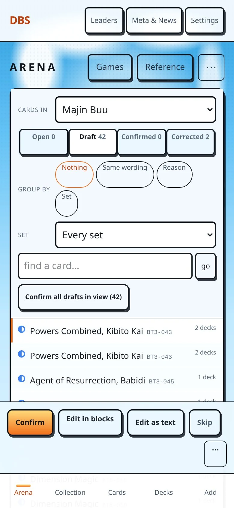
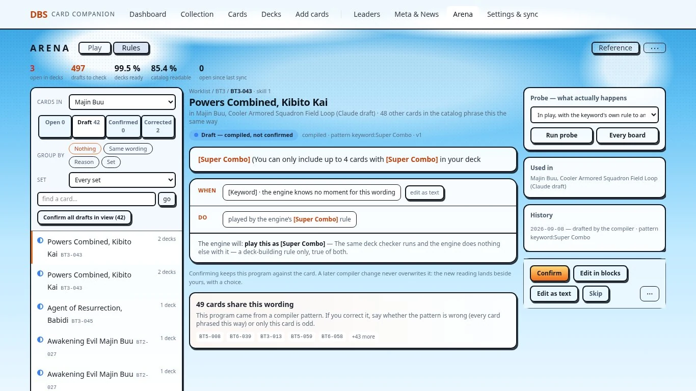

## Walkthrough: compare one skill

`/arena/rules/review?deck=6` focuses on Babidi, one of 40 eligible skills. The workbench has 42 drafts for this deck: two flagged drafts are excluded from the phone review queue. Explain such exclusions instead of showing apparently conflicting totals. WHEN/COST/IF/DO are interpretation parts; “not tied to printed words” means missing text alignment, not necessarily an extra or incorrect effect. The full interpretation and cross-card approval lie below the initial viewport, while verdict buttons stay fixed.

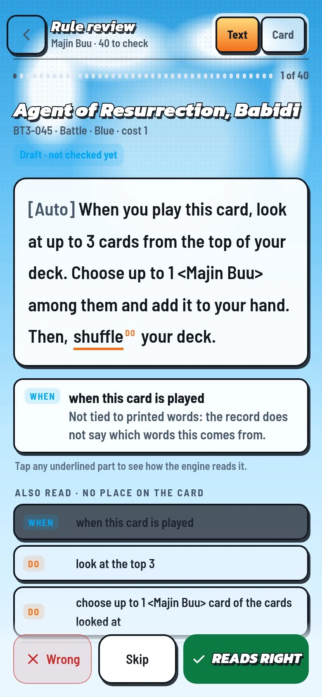
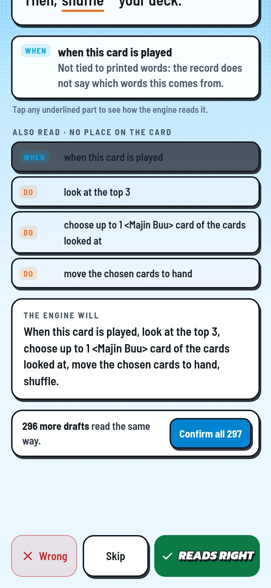
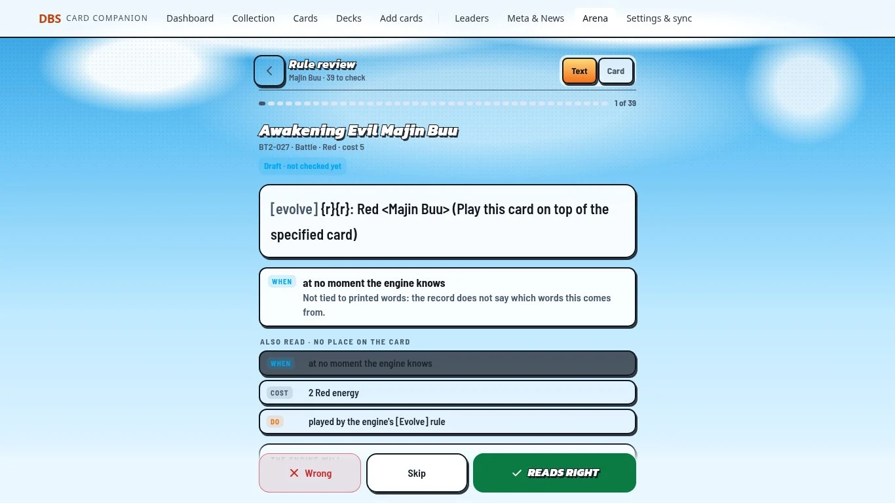

## Walkthrough: decide and recover

Wrong opens a report with clause, reason and optional note. Its submission says “Flag for the computer,” even though the sheet also links to the correction builder on this device. The success message says the card waits in Rules on the computer. Neither reporting nor flagging corrects its behavior.

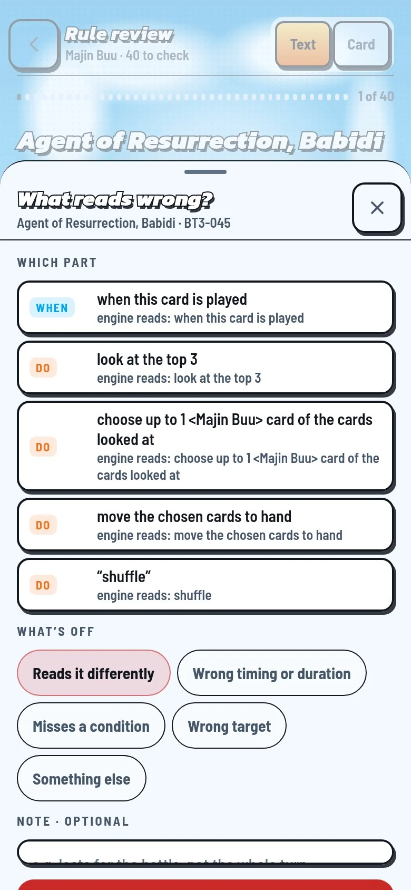
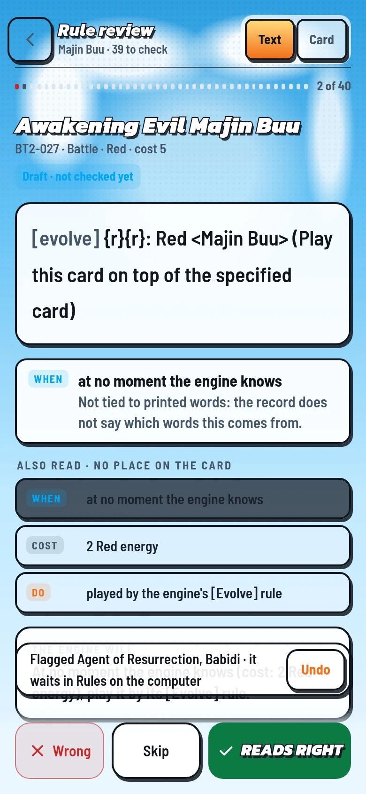

## Walkthrough: correct and test

The selected laptop record presents printed text, interpretation, confirmation and edit choices together. The full-screen builder exposes Blocks, Text, In my words and Like a card at once. It needs guidance about when to use each, and a return to the same queue/card. A generated test's “Right/Wrong” judges an observed board; this must be distinguished from the review verdict and correction save.

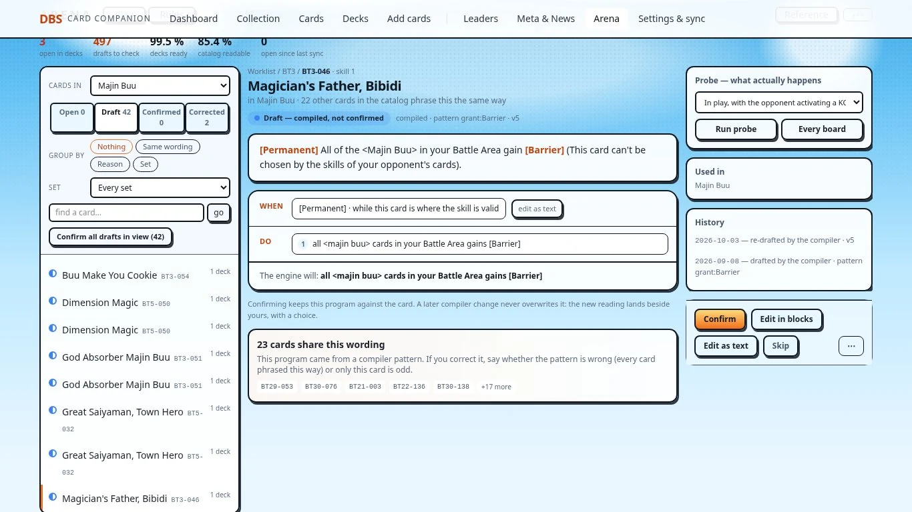
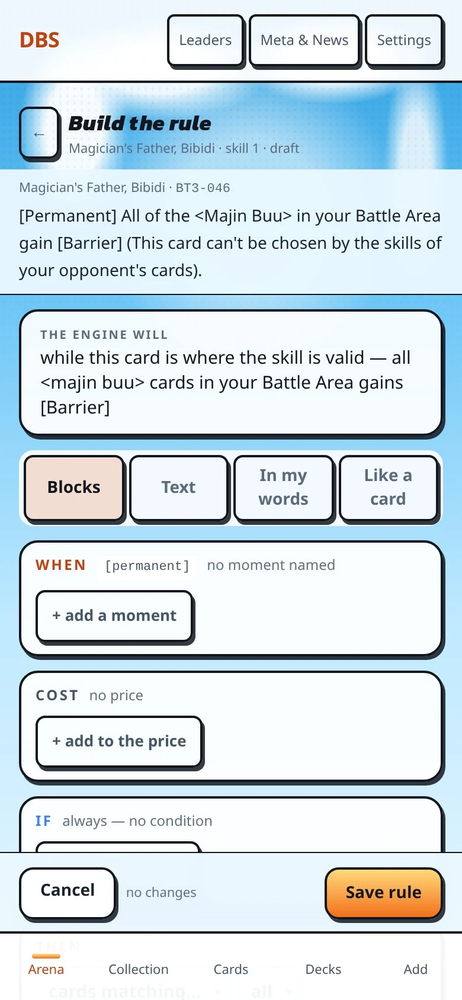
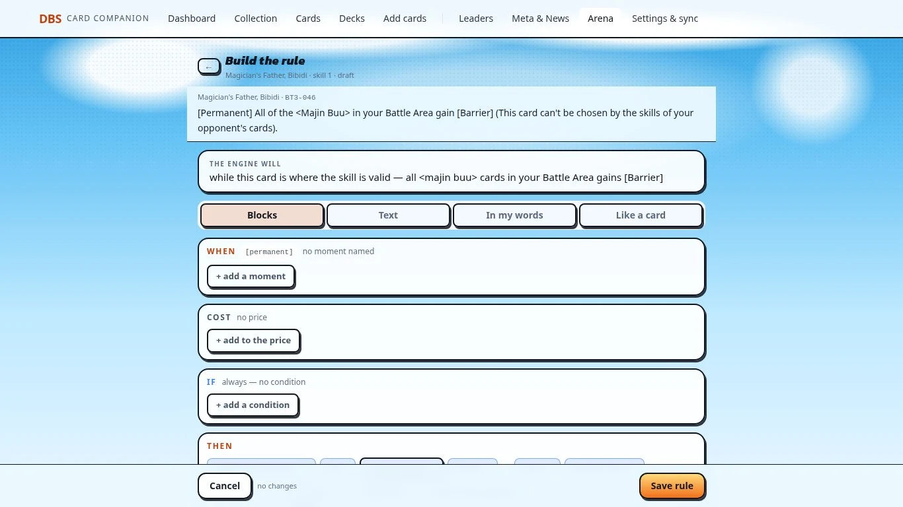
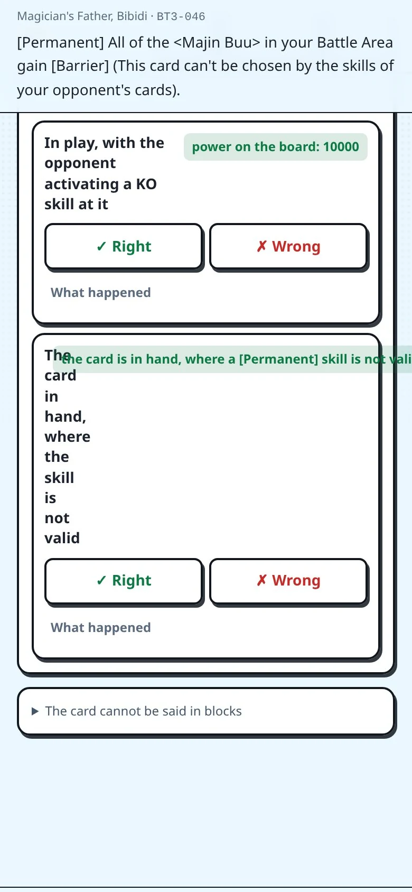
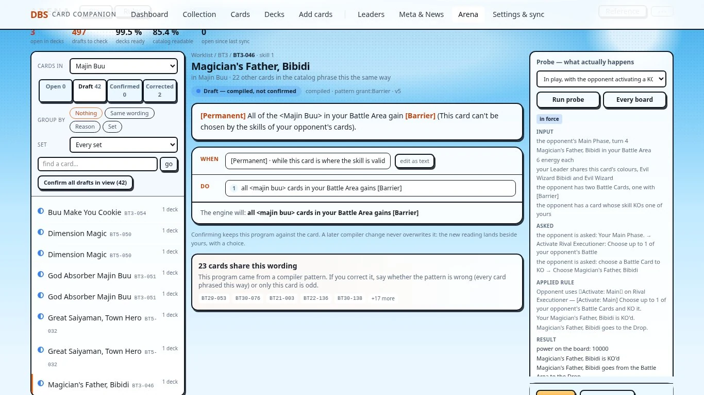

The phone test capture visibly overflows horizontally: long result text squeezes its adjacent title into a narrow column. A meaningful test outcome should be readable before the user chooses whether it matches expectations.

## Walkthrough: help and advanced reference

Keywords explain manual meaning and runtime limitations, which remain useful during a review. Grammar and game declarations primarily explain engine internals. They should be reachable as advanced help rather than competing with “review this card.”

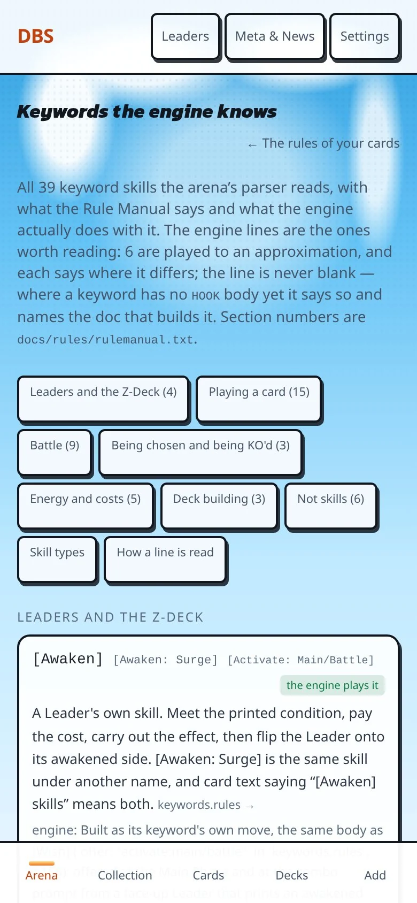
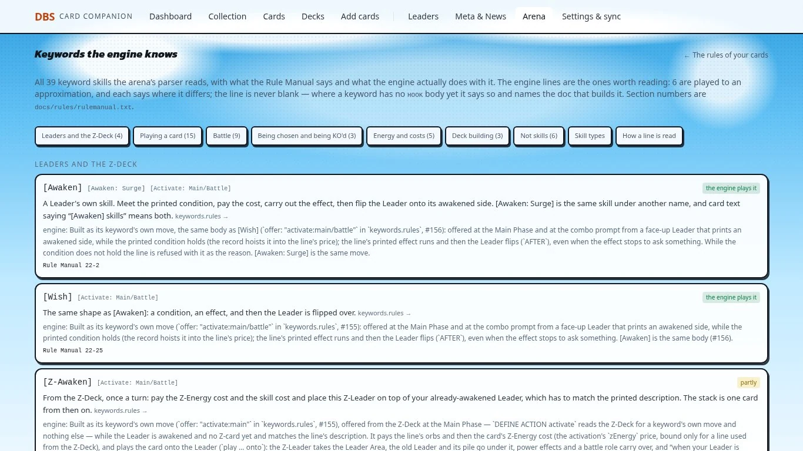
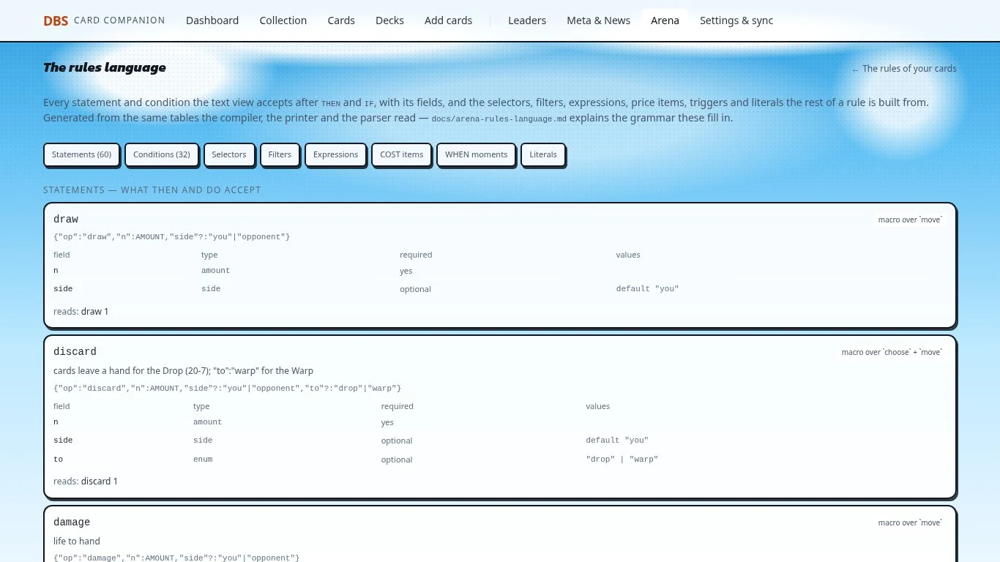
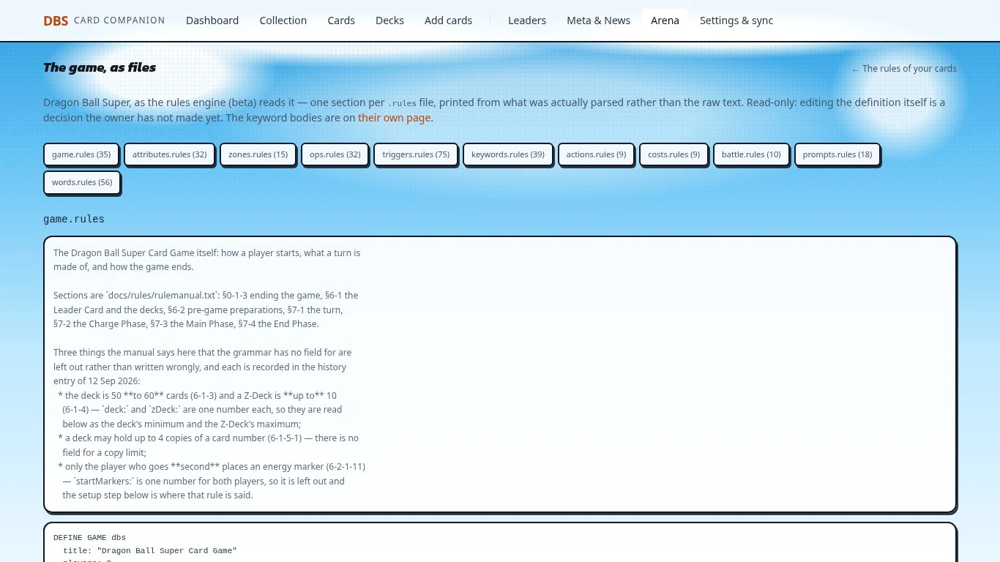

## Proposed guided procedure (initial recommendation)

1. **Choose what to review.** Choose one playable Masters deck, a named card, or a rule reached from a flagged game. Show deck name, skill counts, queued reasons and any excluded/flagged items. Offer all decks and the catalog as deliberate wider scopes.
2. **Compare this skill.** Show “Printed on the card” and “Current interpretation,” with “When it happens,” “What you pay,” “Requirements” and “What it does.” Explain missing text links and unread parts. Keep review state separate from engine support and test results.
3. **Choose the next action.** “Approve interpretation” saves approval; “Report a mismatch” records an issue; “Review later” leaves it queued. Show the result of each action before selection, and Undo after a change. An unread/blank rule needs a draft or correction, not approval.
4. **Correct if needed.** “Edit interpretation” opens the block editor by default. Choose an affected clause, explain the desired behavior, and optionally request an AI draft. Put text/JSON and shared-pattern operations under Advanced. Reporting also offers “Correct now” or a clear return to the flagged queue.
5. **Test behavior.** State whether testing the saved rule or unsaved editor changes. Show scenario setup, expected outcome, observed outcome and limitations. Use “Matches expected behavior” / “Does not match” for test judgments. Do not turn execution or a generic green result into approval.
6. **Save and continue.** “Save correction” explains that it changes the saved rule; “Discard changes” explains that it does not. Return to the same deck/card/filter context. Summarize approved, corrected, reported, skipped and still-unread separately; never call the whole deck fixed merely because a sitting ended.

Phone: full-screen steps, compact persistent deck/card/step context, readable vertical comparisons, a reachable footer and no horizontal overflow. Laptop: retain the useful queue and side-by-side comparison, but give the selected rule the same steps, wording and outcomes. Contextual help should return to the same step.

Tiny Fish findings and final priorities will be added after its review of this packet.
